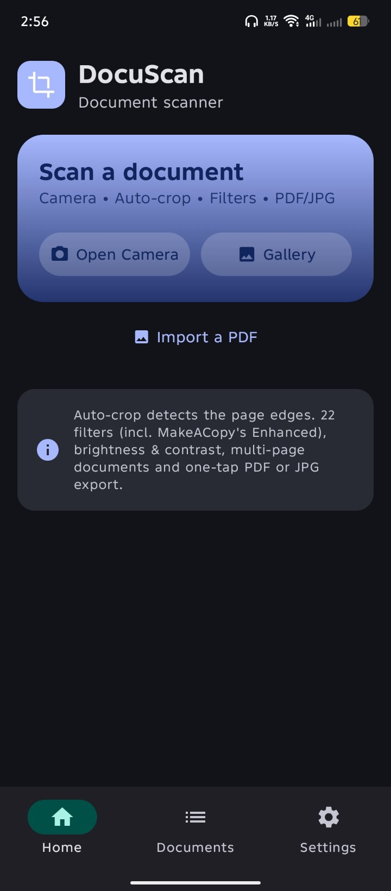
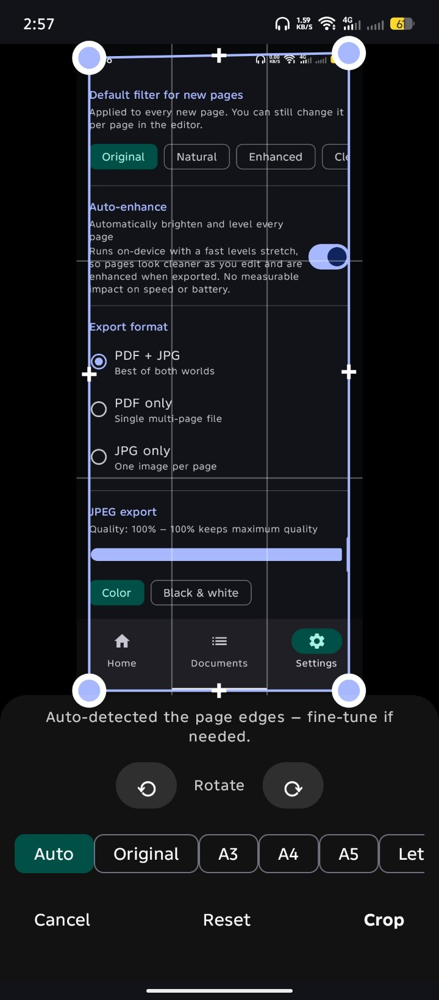
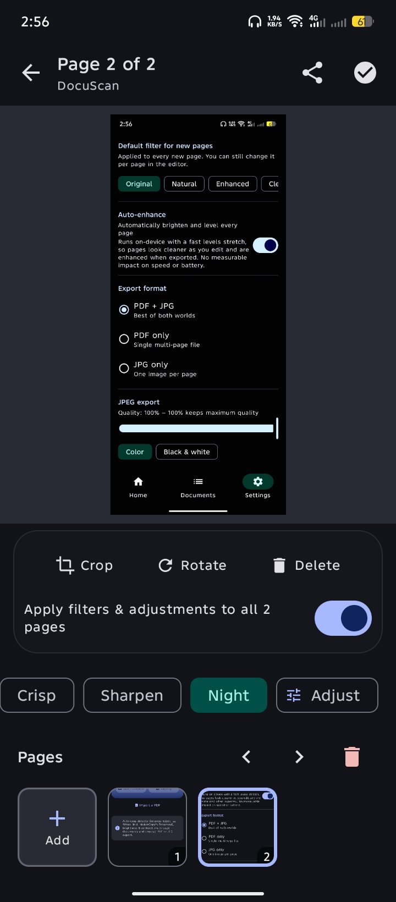
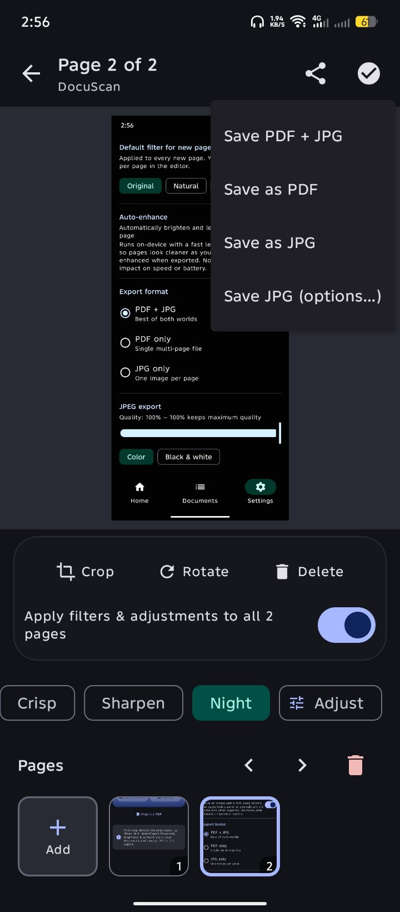
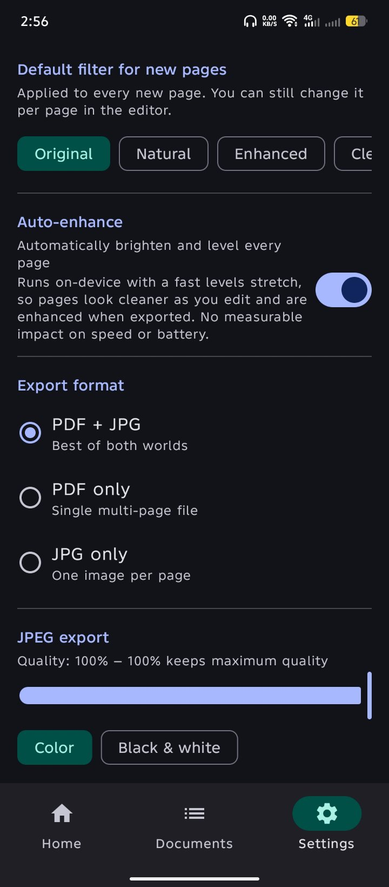

# KrizScan 📄

A modern, local-first Android document scanner. Capture or import images, apply 22 filters, crop and rotate each page, and export as PDF or JPG.

Built with **Kotlin + Jetpack Compose (Material 3) + CameraX**, modeled after the MakeACopy feature set.

## Screenshots

<p align="center">
  
  
  
  
  
</p>
<p align="center"><sub>Home &nbsp;·&nbsp; Auto-crop &nbsp;·&nbsp; Editor &nbsp;·&nbsp; Save menu &nbsp;·&nbsp; Settings</sub></p>

## Features

- 📷 **Camera capture** with in-app preview, flash & front/back flip (CameraX)
- 🖼️ **Gallery import** (system photo picker — no storage permissions needed) with **multi-select** — pick as many images as the system allows (up to 100 at once) and they all become pages
- 📄 **PDF import** — open an existing PDF and its pages become editable pages
- 🧭 **Manual crop** — drag the four corners or the edges (parallel edge translation), with a snap-to-right-angle assist.
- 🔄 **Rotate** — rotate a page 90° at a time, either in the editor or while cropping; the editor preview updates instantly
- 🧩 **Batch editing** — with several pages loaded, the editor's "apply to all pages" switch makes changes hit every page at once
- ✨ **Auto-enhance** — every page is auto-levelled with hardware-accelerated colour-matrix pass
- 🔎 **Full-resolution pipeline** — imported photos are kept at their original resolution
- ✨ **Document cleanup** — Natural, Enhanced and Clean Text (background flattening, CLAHE local contrast, clean-up)
- 🎨 **22 filters** + Text Watermarks & Overlays
- 🔆 **Brightness & contrast** sliders
- 📚 **Multi-page documents**
- 📄 **Export** — PDF with page formats and quality presets; JPG with configurable quality
- 📨 **Inbox Mode** — pick a folder (SAF) and every export is automatically saved there too
- ♿ **Accessibility Mode** — spoken + haptic feedback and volume-key shutter in the camera
- ⬆️ **In-app updates** — check GitHub Releases feed
- 📤 **Share** with one tap (PDF or JPG)
- 🗂️ **Document library** — browse, view, re-share or delete past scans
- 📨 **Share-to-scan** — open an image from any app with "Send to KrizScan"
- 🌙 **Modern Material 3 UI**

Scanning, filtering and export all happen **on-device** — no accounts and no uploads.

## Repository & Releases

Source code and releases available on [GitHub: altkriz/KrizScan](https://github.com/altkriz/KrizScan).

## Building locally

```bash
# JDK 17 required
./gradlew :app:assembleDebug     # debug build
./gradlew :app:assembleRelease   # release build
```

- **minSdk**: 26 (Android 8.0)
- **targetSdk**: 36

## Project layout

```
app/src/main/java/com/kriztech/scan/
├── MainActivity.kt        # Compose entry point + volume-key shutter (A11y)
├── App.kt                 # Navigation + bottom bar
├── A11y.kt                # Accessibility Mode: TTS + haptics
├── DocViewModel.kt        # Shared state (pages, settings, history)
├── scan/                  # The engine
│   ├── Cleanup.kt         # OpenCV document cleanup (Natural/Enhanced/Clean Text) + corner detector
│   ├── WarpTarget.kt      # Warp target size: Zhang & He projective estimate + fixed ratios
│   ├── ImageFilters.kt    # 22 filters (incl. MakeACopy cleanup presets) + Otsu B&W + sharpen
│   ├── CropGeometry.kt    # Edge dragging + snap-to-right-angle geometry (MakeACopy port)
│   ├── CropAspectRatio.kt # Crop aspect-ratio presets enforced at warp time
│   ├── PdfImport.kt       # PdfRenderer -> page bitmaps
│   ├── BitmapUtil.kt      # Rotate/crop/perspective-warp/EXIF/grayscale
│   ├── PdfExporter.kt     # android.graphics.pdf PDF writer (page format + DPI presets)
│   ├── MediaSaver.kt      # MediaStore saves + inbox folder writes
│   └── Exporter.kt        # Export pipeline (PDF/JPG + inbox mirror)
├── data/                  # History + settings persistence + PDF page-format/quality options
├── update/Updater.kt      # GitHub Releases update check + APK download/install
├── ui/                    # Screens (Home, Camera, Editor, Crop, Documents, Settings) + UpdateDialog
└── util/ShareUtil.kt      # Sharing via FileProvider
```

## Third-party licenses

- **OpenCV 4.13.0** (Apache 2.0) — corner detection and document cleanup presets, like MakeACopy.

## License

MIT — see [LICENSE](LICENSE).
